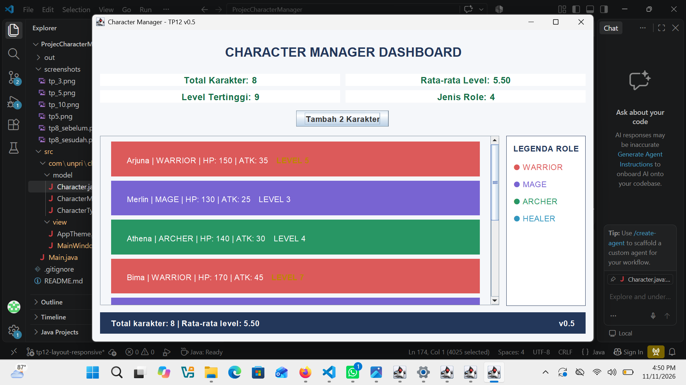
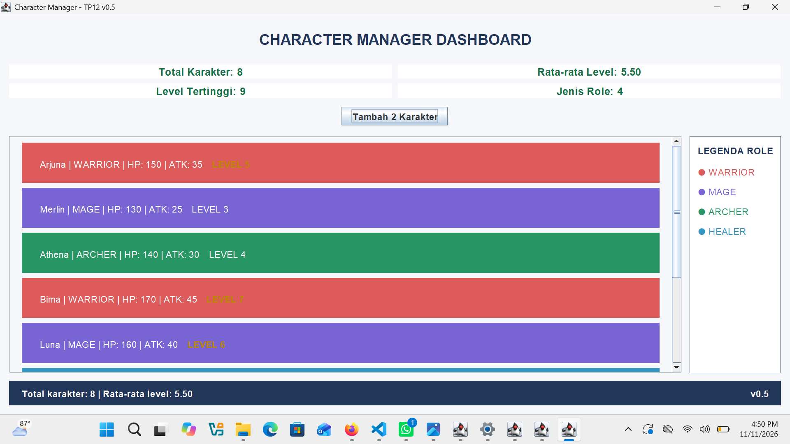
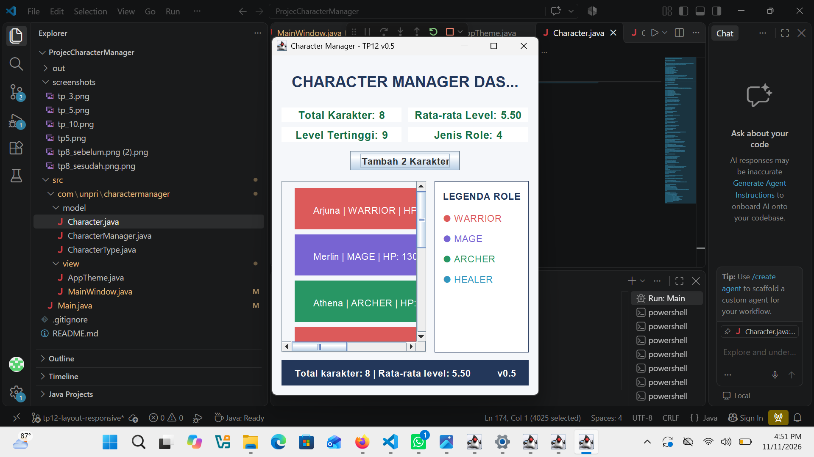

# Character Manager — TP3, TP5 & TP8

**Java Visual SIH-6406**

## 1. Deskripsi Proyek

Character Manager adalah aplikasi sederhana berbasis Java yang digunakan untuk mengelola karakter dalam sebuah game. Proyek ini dibuat untuk menerapkan konsep Object-Oriented Programming (OOP), seperti Class, Object, Constructor, Encapsulation, Getter, Setter, Enum, ArrayList, Object Reference, serta GUI menggunakan Java Swing.

## 2. Fitur Program TP3

- Membuat objek karakter menggunakan constructor.
- Menampilkan informasi karakter.
- Mengubah level karakter (Level Up).
- Mengatur nilai Mana karakter.
- Memvalidasi agar Mana tidak bernilai negatif.
- Memeriksa status karakter menggunakan method `isAlive()`.
- Menggunakan Enum untuk menentukan jenis karakter.

## 3. Jenis Karakter

Program memiliki empat jenis karakter:

- WARRIOR
- MAGE
- ARCHER
- HEALER

## 4. Struktur Folder Proyek

```text
ProjecCharacterManager/
│
├── src/
│   ├── Main.java
│   └── com/
│       └── unpri/
│           └── charactermanager/
│               ├── model/
│               │   ├── Character.java
│               │   ├── CharacterType.java
│               │   └── CharacterManager.java
│               │
│               └── view/
│                   └── MainWindow.java
│
├── screenshots/
│   ├── tp_3.png
│   ├── tp_5.png
│   ├── tp5.png
│   ├── tp8_sebelum.png
│   └── tp8_sesudah.png
│
└── README.md
```

## 5. Screenshot Hasil Program TP3

Screenshot berikut menunjukkan hasil eksekusi aplikasi Character Manager pada TP3.


## 6. Identitas Mahasiswa

- **Nama:** Jesy Pranisya Br Bangun
- **NIM:** 253303621230
- **Program Studi:** Sistem Informasi
- **Universitas:** Universitas Prima Indonesia
- **Mata Kuliah:** Pemrograman Berorientasi Objek
- **Tugas:** Character Manager Sprint #1 (TP3), Sprint #2 (TP5), dan Sprint #3 (TP8)

## 7. Dokumentasi Google Docs TP3

Dokumentasi analisis dan pembahasan tugas TP3 dapat dibuka melalui tautan berikut:

[Klik di sini untuk membuka Google Docs TP3](https://docs.google.com/document/d/1u7Xp926uOyoA4-ykONDtI0S-yILRtdFkxvSFbVrXS6k/edit?usp=sharing)

---

# TP5 — Character Manager Sprint #2

## 8. Fitur yang Diimplementasikan

Pada TP5, aplikasi dikembangkan dengan menambahkan pengelolaan karakter menggunakan ArrayList dan beberapa method tambahan.

1. **equals():** Membandingkan karakter berdasarkan nama tanpa membedakan huruf besar dan kecil.
2. **addCharacter():** Menambahkan karakter baru dan menolak nama karakter yang duplikat.
3. **findByName():** Mencari karakter berdasarkan nama.
4. **removeCharacter():** Menghapus karakter dari daftar.
5. **getTotalCharacters():** Menghitung jumlah karakter yang tersimpan.
6. **getAllCharacters():** Mengembalikan salinan daftar karakter agar daftar asli tidak dapat diubah melalui daftar hasil pengembalian.
7. **getAverageLevel():** Menghitung rata-rata level karakter dan menghasilkan 0 jika daftar kosong.
8. **findByType():** Mencari karakter berdasarkan jenis karakter.
9. **findStrongest():** Menemukan karakter dengan attack power tertinggi.
10. **Static Counter:** Menghitung jumlah objek Character yang telah dibuat.

## 9. Hasil Pengujian TP5

Pengujian dilakukan melalui program Main.java.

Hasil pengujian menunjukkan:

- Penambahan empat karakter berhasil.
- Nama karakter duplikat berhasil ditolak.
- Pencarian karakter Merlin berhasil.
- Penghapusan karakter Athena berhasil.
- Jumlah karakter setelah penghapusan menjadi 3.
- Rata-rata level karakter menghasilkan 5.0.
- Rata-rata pada daftar kosong menghasilkan 0.0.
- Pencarian karakter berdasarkan tipe WARRIOR berhasil.
- Pengujian salinan ArrayList berhasil.
- Pengujian object reference berhasil.
- Method equals() berhasil membandingkan nama karakter.
- Method findStrongest() berhasil menemukan karakter Bima.
- Static counter berhasil menghitung 9 objek yang dibuat.

## 10. Alasan Memilih Fitur findStrongest()

Fitur `findStrongest()` dipilih karena dapat membantu mengetahui karakter yang memiliki attack power tertinggi. Fitur ini berguna dalam pengelolaan karakter game dan melatih penggunaan perulangan, percabangan, serta pengambilan data dari ArrayList.

## 11. Screenshot Hasil Program TP5

### Screenshot 1


### Screenshot 2


## 12. Dokumentasi Google Docs Analisis TP5

Dokumentasi analisis TP5 membahas beberapa materi, yaitu:

- Perbedaan primitive dan reference semantics.
- Alasan penggunaan static counter.
- Perbedaan Object.equals() dan equals() yang telah diubah.
- Risiko mengembalikan ArrayList asli.
- Kesimpulan hasil pembelajaran TP5.

[Klik di sini untuk membuka Google Docs Analisis TP5](https://docs.google.com/document/d/1svYh4hBYZgDiVfs09uO9_eJbhdlQZNbQ-I89CVYntXw/edit?usp=sharing)

---

# TP8 — Character Manager Sprint #3

## 13. Fitur yang Diimplementasikan

Pada TP8, aplikasi Character Manager dikembangkan menggunakan Java Swing untuk menampilkan data karakter melalui antarmuka grafis (GUI).

Fitur yang ditambahkan:

1. **MainWindow:** Membuat jendela aplikasi menggunakan `JFrame`.
2. **Tampilan Karakter Dinamis:** Menampilkan daftar karakter berdasarkan data yang tersimpan di CharacterManager.
3. **SwingUtilities.invokeLater():** Menjalankan pembuatan GUI pada Event Dispatch Thread.
4. **Penambahan Karakter:** Menambahkan dua karakter baru melalui tombol Tambah 2 Karakter.
5. **Statistik Rata-rata Level:** Menampilkan rata-rata level seluruh karakter menggunakan JLabel.
6. **Refresh Tampilan:** Memperbarui daftar karakter dan statistik setelah data berubah.

## 14. Hasil Pengujian TP8

Pengujian dilakukan dengan menjalankan aplikasi melalui Main.java.

Pada tampilan awal, aplikasi menampilkan lima karakter:

- Arjuna — WARRIOR, Level 5.
- Merlin — MAGE, Level 3.
- Athena — ARCHER, Level 4.
- Bima — WARRIOR, Level 7.
- Luna — MAGE, Level 6.

Rata-rata level awal adalah **5.00**.

Setelah tombol **Tambah 2 Karakter** ditekan, aplikasi berhasil menambahkan:

- Raphael — HEALER, Level 8.
- Diana — ARCHER, Level 9.

Jumlah karakter menjadi tujuh dan rata-rata level berubah menjadi **6.00**. Hal ini menunjukkan bahwa daftar karakter dan statistik berhasil diperbarui secara dinamis.

## 15. Screenshot Hasil Program TP8

### Screenshot Sebelum Penambahan Karakter

Menampilkan lima karakter awal dengan rata-rata level 5.00.


### Screenshot Sesudah Penambahan Karakter

Menampilkan tujuh karakter setelah Raphael dan Diana ditambahkan, dengan rata-rata level 6.00.


## 16. Analisis Alur Data dan Konsep MVC

Pada aplikasi TP8, Main.java bertugas membuat objek CharacterManager dan memasukkan data karakter awal. Selanjutnya, objek CharacterManager diberikan kepada MainWindow agar data karakter dapat ditampilkan pada antarmuka aplikasi. MainWindow mengambil daftar karakter dan nilai rata-rata level untuk ditampilkan menggunakan komponen Swing. Ketika tombol Tambah 2 Karakter ditekan, data baru dimasukkan ke CharacterManager, kemudian tampilan daftar dan statistik diperbarui.

Dalam konsep MVC (Model-View-Controller), Character dan CharacterManager termasuk bagian Model karena mengelola data dan aturan karakter. MainWindow berperan sebagai View karena menampilkan data kepada pengguna. Main.java mengatur proses awal aplikasi dan menghubungkan Model dengan View; pada arsitektur MVC yang lebih lengkap, pengolahan aksi pengguna dapat dipisahkan ke Controller tersendiri.

## 17. Dokumentasi Google Docs Analisis TP8

Dokumentasi analisis TP8 membahas:

- Perbedaan pendekatan sequential dan event-driven.
- Fungsi SwingUtilities.invokeLater() dan pentingnya Event Dispatch Thread.
- Perbaikan kode JFrame agar jendela dapat ditampilkan.
- Perbedaan konsep is-a dan has-a.
- Penempatan proses pengambilan data dan penampilan JLabel dalam konsep MVC.

**Tautan Google Docs TP8:**  
[[Klik di sini untuk membuka Google Docs Analisis TP8](https://docs.google.com/document/d/1Tif4b57X0oe2zcQsoW5oxGjp2tKffj0in2KwgxjQtd0/edit?usp=sharing)]

---

## 18. Kesimpulan

Melalui TP3, TP5, dan TP8, aplikasi Character Manager dikembangkan secara bertahap. TP3 menerapkan dasar-dasar OOP, TP5 menambahkan pengelolaan data karakter menggunakan ArrayList, sedangkan TP8 mengembangkan aplikasi menjadi GUI menggunakan Java Swing. Pengembangan ini membantu memahami penerapan OOP, pengelolaan data dinamis, event-driven programming, dan konsep MVC dalam pemrograman Java.

---

---

# Character Manager Sprint #4 — TP10

**Theming, Properti Komponen & Analisis MVC**

CPMK 2 · SCPMK 4

## 1. Hasil Implementasi

Pada TP10, aplikasi Character Manager dikembangkan dengan menggunakan class `AppTheme` untuk mengatur warna, font, dan border agar tampilan lebih konsisten.

Fitur yang ditambahkan:
- Warna kartu karakter berdasarkan role.
- Level minimal 5 ditampilkan dengan warna emas dan font tebal.
- Statistik jumlah karakter dan rata-rata level.
- Tampilan menggunakan layout yang menyesuaikan ukuran komponen.

## 2. Screenshot Hasil

### Sebelum TP10 (v0.3)
Masukkan screenshot versi sebelumnya di folder `screenshots`.

### Sesudah TP10 (v0.4)


## 3. Analisis MVC

Warna dan tampilan aplikasi ditempatkan di `AppTheme` karena pengaturan tersebut merupakan tanggung jawab bagian View. Dengan pemisahan ini, class Model tidak perlu mengetahui warna atau desain antarmuka. Jika desain aplikasi berubah, pengaturan dapat diperbarui melalui `AppTheme` tanpa mengubah logika data karakter. Hal ini membuat kode lebih rapi dan mudah dipelihara.

## 4. Properti Komponen Tambahan

1. **ToolTipText**: Menampilkan informasi nama, role, HP, ATK, dan level ketika pengguna mengarahkan kursor ke kartu karakter.
2. **Opaque**: Mengatur agar background panel dan kartu karakter terlihat sesuai warna yang telah ditentukan.

## 5. Google Docs Analisis TP10

Link Google Docs: [## 5. Google Docs Analisis TP10

Dokumen analisis TP10:

[JavaVisual_TP10_253303621230_Jesy_Pranisya_Br_Bangun](https://docs.google.com/document/d/1tbPqoyw5vdPTwL-MrhJTH4a1lXjTV1tgzU8ETMpYunU/edit?usp=sharing)]

---

# Character Manager Sprint #5 — TP12

## Layout, UI Responsif & Analisis MVC

**CPMK 2 · SCPMK 5**

### 1. Hasil Implementasi TP12

Pada TP12, aplikasi Character Manager dikembangkan menggunakan `BorderLayout` untuk membagi tampilan menjadi empat bagian utama, yaitu:

1. **NORTH (Header):** Menampilkan judul aplikasi, statistik karakter, dan tombol tambah karakter.
2. **CENTER (Daftar Karakter):** Menampilkan kartu karakter menggunakan `BoxLayout` dan `JScrollPane` agar daftar dapat digulir.
3. **EAST (Legenda Role):** Menampilkan jenis karakter berdasarkan `CharacterType.values()`.
4. **SOUTH (Status Bar):** Menampilkan informasi jumlah karakter, rata-rata level, dan versi aplikasi v0.5.

Fitur tambahan:
- Panel statistik menggunakan `GridLayout` 2 baris dan 2 kolom.
- Panel tombol menggunakan `FlowLayout`.
- Daftar karakter dapat digulir ketika ruang tampilan tidak mencukupi.
- Tampilan menyesuaikan perubahan ukuran jendela.
- Menampilkan minimal delapan karakter dengan variasi role dan level.

### 2. Wireframe Layout

Berikut gambaran susunan tampilan aplikasi TP12:

```text
+-------------------------------------------------------+
|                    HEADER (NORTH)                     |
|              CHARACTER MANAGER DASHBOARD              |
|                                                       |
|  Total Karakter | Rata-rata | Level Tertinggi | Role  |
|                                                       |
|                 [Tambah 2 Karakter]                   |
+-------------------------------------------+-----------+
|                                           |           |
|            DAFTAR KARAKTER                |  LEGENDA  |
|                 (CENTER)                  |   (EAST)  |
|                                           |           |
|  [Arjuna - WARRIOR - Level 5]             | WARRIOR   |
|  [Merlin - MAGE - Level 3]                | MAGE      |
|  [Athena - ARCHER - Level 4]              | ARCHER    |
|  [Bima - WARRIOR - Level 7]               | HEALER    |
|  [Luna - MAGE - Level 6]                  |           |
|  [Karakter lainnya...]                    |           |
|                                           |           |
+-------------------------------------------+-----------+
|                 STATUS BAR (SOUTH)                    |
|  Total karakter dan rata-rata level             v0.5 |
+-------------------------------------------------------+
```

### 3. Screenshot Hasil Program TP12

**Screenshot 1 — Ukuran Awal**

Menampilkan aplikasi ketika pertama kali dijalankan tanpa mengubah ukuran jendela.



**Screenshot 2 — Ukuran Lebar**

Menampilkan aplikasi setelah jendela diperlebar. Tampilan panel dan daftar karakter menyesuaikan ruang yang tersedia.



**Screenshot 3 — Ukuran Kecil**

Menampilkan aplikasi setelah ukuran jendela diperkecil sehingga scrollbar dapat digunakan untuk melihat daftar karakter.



### 4. Pengamatan Perubahan Ukuran Jendela

| Kondisi | Prediksi | Hasil Pengamatan |
|---|---|---|
| Ukuran awal | Semua bagian utama terlihat | Tampilan awal aplikasi terlihat |
| Ukuran lebar | Ruang daftar karakter bertambah | Panel menyesuaikan ukuran jendela |
| Ukuran kecil | Daftar karakter dapat digulir | Scrollbar digunakan untuk melihat karakter |

### 5. Struktur Nested Panel

Aplikasi menggunakan beberapa panel yang disusun secara bertingkat. `mainPanel` menjadi panel utama dengan `BorderLayout` yang menampung header, daftar karakter, legenda role, dan status bar. Di dalam header terdapat panel statistik menggunakan `GridLayout` serta panel tombol menggunakan `FlowLayout`. Daftar karakter ditempatkan di dalam `characterWrapper`, kemudian dimasukkan ke `JScrollPane` agar dapat digulir. Panel legenda menggunakan `BoxLayout` dengan susunan vertikal untuk menampilkan setiap jenis karakter.

### 6. Alasan Pemilihan Layout

`BorderLayout` dipilih sebagai layout utama karena dapat membagi jendela menjadi empat wilayah sehingga susunan aplikasi lebih teratur. `GridLayout` dipilih untuk panel statistik karena setiap informasi memiliki ukuran dan susunan yang konsisten. `BoxLayout` digunakan pada daftar karakter dan legenda karena komponennya disusun secara vertikal. Sementara itu, `FlowLayout` digunakan pada panel tombol agar tombol dapat ditempatkan secara sederhana dan rapi.

Layout absolut menggunakan `setLayout(null)` dan `setBounds()` tidak dipilih karena posisi dan ukuran komponen harus diatur secara manual. Hal tersebut membuat tampilan lebih sulit menyesuaikan diri ketika ukuran jendela berubah.

### 7. Google Docs Analisis TP12

Dokumentasi analisis TP12 membahas:

- Kelemahan penggunaan `setLayout(null)` dan `setBounds()`.
- Fungsi LayoutManager dan preferred size.
- Perilaku `BorderLayout` ketika ukuran jendela berubah.
- Perbandingan `GridLayout` dan `BoxLayout`.
- Alasan kode layout ditempatkan pada bagian View dalam konsep MVC.
- Fungsi `revalidate()` dan `repaint()` dalam memperbarui tampilan.

**Link Google Docs Analisis TP12:**

[Klik di sini untuk membuka Google Docs Analisis TP12](**Link Google Docs Analisis TP12:**

[Klik di sini untuk membuka Google Docs Analisis TP12](https://docs.google.com/document/d/1mxBX7FDwdblk6iUEw6Hq1VEyviyUGTD8Rfb7cAsY7g0/edit?usp=sharing))

### 8. Identitas Mahasiswa

Nama: Jesy Pranisya Br Bangun  
NIM: 253303621230  
Program Studi: Sistem Informasi  
Universitas: Universitas Prima Indonesia  
Mata Kuliah: Pemrograman Berorientasi Objek  
Tugas: Character Manager Sprint #5 (TP12)

---