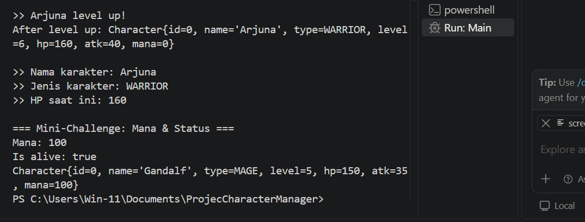

# Character Manager — TP3 (Java Visual SIH-6406)

## 1. Deskripsi Proyek

Character Manager adalah aplikasi sederhana berbasis Java yang digunakan untuk mengelola karakter dalam sebuah game. Proyek ini dibuat untuk menerapkan konsep Object-Oriented Programming (OOP) seperti Class, Object, Constructor, Encapsulation, Getter, Setter, dan Enum.

## 2. Fitur Program

- Membuat objek karakter menggunakan constructor.
- Menampilkan informasi karakter.
- Mengubah level karakter (Level Up).
- Mengatur nilai Mana karakter.
- Memvalidasi agar Mana tidak bernilai negatif.
- Memeriksa status karakter menggunakan method `isAlive()`.
- Menggunakan Enum untuk menentukan jenis karakter.

## 3. Jenis Karakter

Program memiliki empat jenis karakter:
- WARRIOR
- MAGE
- ARCHER
- HEALER

## 4. Struktur Folder

```text
ProjecCharacterManager/
│
├── src/
│   ├── Main.java
│   └── com/
│       └── unpri/
│           └── charactermanager/
│               └── model/
│                   ├── Character.java
│                   └── CharacterType.java
│
├── screenshots/
│   └── tp_3.png
│
└── README.md
```

## 5. Screenshot Hasil Program

Screenshot berikut menunjukkan hasil eksekusi aplikasi Character Manager TP3.



## 6. Identitas Mahasiswa

- **Nama:** Jesy Pranisya Br Bangun
- **NIM:** 253303621230
- **Program Studi:** Sistem Informasi
- **Universitas:** Universitas Prima Indonesia
- **Tugas:** Character Manager Sprint #1 (TP3)
- **Mata Kuliah:** Pemrograman Berorientasi Objek

## 7. Dokumentasi Google Docs

Dokumentasi analisis dan pembahasan TP3 dapat dilihat melalui tautan berikut:

[BUKA DOKUMENTASI GOOGLE DOCS TP3](https://docs.google.com/document/d/1u7Xp926uOyoA4-ykONDtI0S-yILRtdFkxvSFbVrXS6k/edit?usp=sharing)