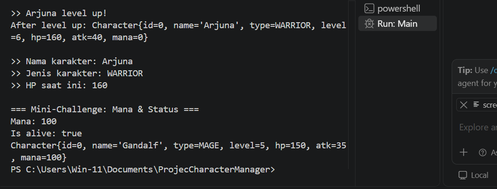
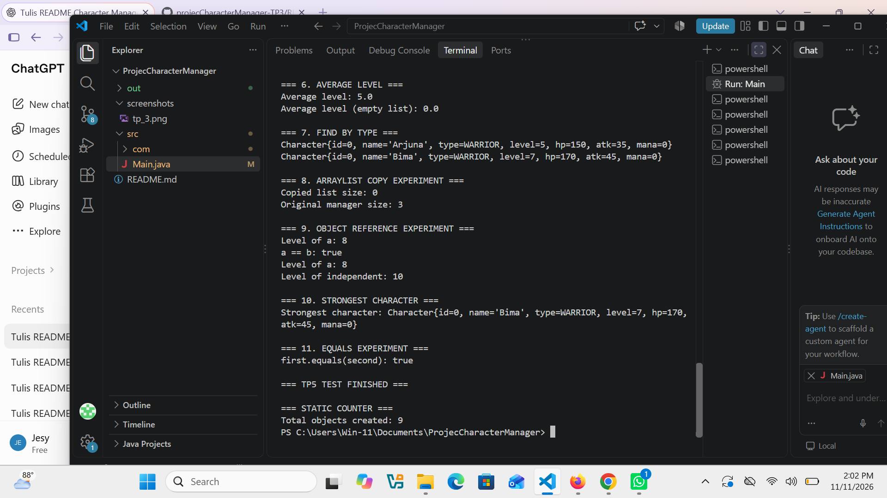
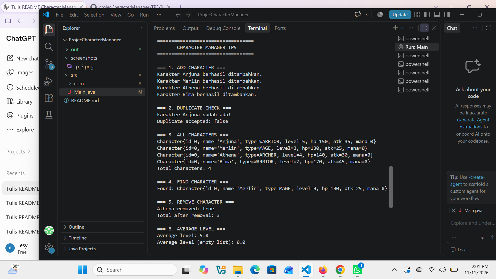
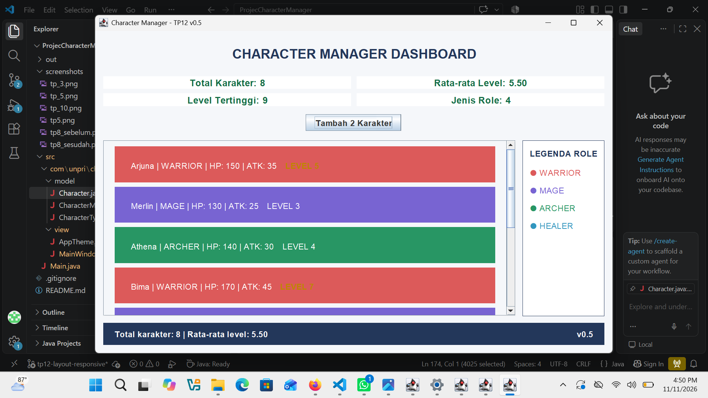
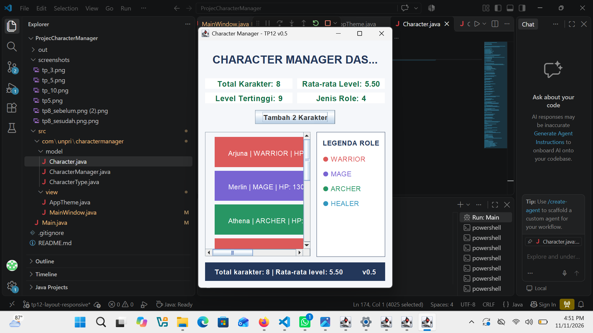
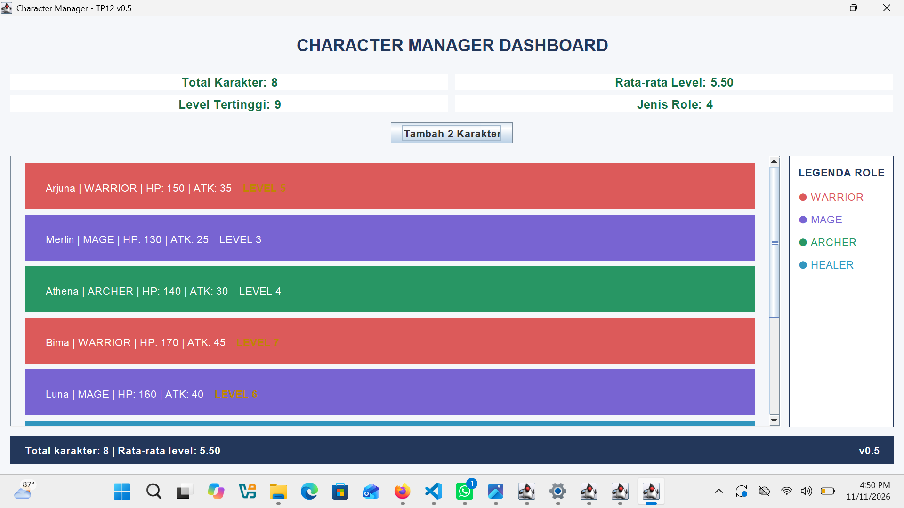
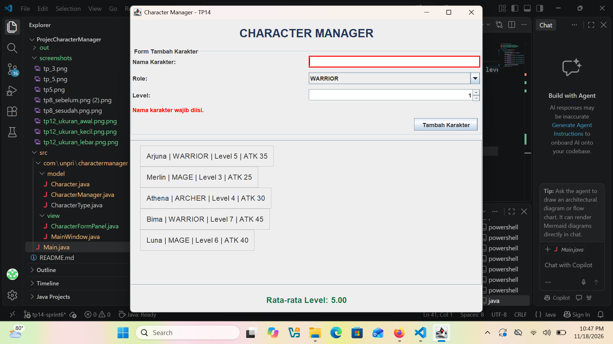
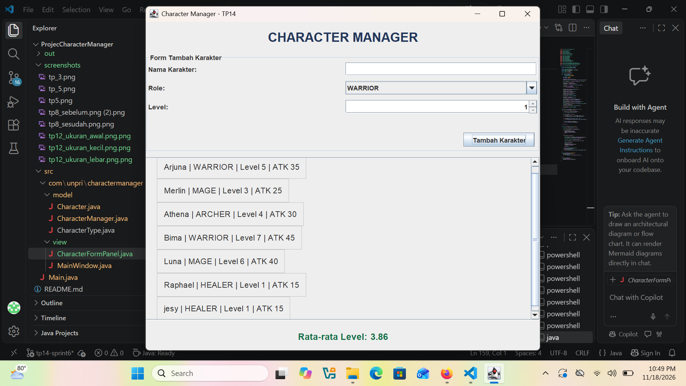

# Character Manager — TP3, TP5, TP8, TP10, TP12 & TP14

**Java Visual SIH-6406**

## 1. Deskripsi Proyek

Character Manager adalah aplikasi sederhana berbasis Java yang digunakan untuk mengelola karakter dalam sebuah game. Proyek ini dikembangkan secara bertahap mulai dari TP3 sampai TP14 untuk menerapkan konsep Object-Oriented Programming (OOP), pengelolaan data menggunakan ArrayList, Java Swing, pengaturan tema, responsivitas tampilan, validasi input, serta konsep Model-View-Controller (MVC).

## 2. Jenis Karakter

Program memiliki empat jenis karakter:

- WARRIOR
- MAGE
- ARCHER
- HEALER

## 3. Struktur Folder Proyek

```text
ProjecCharacterManager/
│
├── src/
│   ├── Main.java
│   └── com/
│       └── unpri/
│           └── charactermanager/
│               ├── model/
│               │   ├── Character.java
│               │   ├── CharacterType.java
│               │   └── CharacterManager.java
│               │
│               └── view/
│                   ├── MainWindow.java
│                   └── CharacterFormPanel.java
│
├── screenshots/
│   ├── tp_3.png
│   ├── tp_5.png
│   ├── tp5.png
│   ├── tp8_sebelum.png
│   ├── tp8_sesudah.png
│   ├── TP10.screenshot-v03.png.png
│   ├── TP10.screenshot-v04.png.png
│   ├── tp12_ukuran_awal.png.png
│   ├── tp12_ukuran_kecil.png.png
│   ├── tp12_ukuran_lebar.png.png
│   ├── tp14_error_kosong.png
│   ├── tp14_error_duplikat.png
│   └── tp14_sukses_raphael.png
│
└── README.md
```

---

# TP3 — Character Manager Sprint #1

## 4. Fitur Program TP3

Pada TP3, aplikasi Character Manager dibuat untuk menerapkan dasar-dasar Object-Oriented Programming (OOP).

Fitur yang dibuat:

1. Membuat objek karakter menggunakan constructor.
2. Menampilkan informasi karakter.
3. Mengubah level karakter menggunakan method Level Up.
4. Mengatur nilai Mana karakter.
5. Memvalidasi agar Mana tidak bernilai negatif.
6. Memeriksa status karakter menggunakan method `isAlive()`.
7. Menggunakan Enum untuk menentukan jenis karakter.

## 5. Screenshot Hasil Program TP3

Screenshot berikut menunjukkan hasil eksekusi aplikasi Character Manager pada TP3.



## 6. Identitas Mahasiswa

- **Nama:** Jesy Pranisya Br Bangun
- **NIM:** 253303621230
- **Program Studi:** Sistem Informasi
- **Universitas:** Universitas Prima Indonesia
- **Mata Kuliah:** Pemrograman Berorientasi Objek
- **Tugas:** Character Manager Sprint #1 (TP3)

## 7. Dokumentasi Google Docs TP3

Dokumentasi analisis dan pembahasan tugas TP3 dapat dibuka melalui tautan berikut:

[Klik di sini untuk membuka Google Docs TP3](https://docs.google.com/document/d/1u7Xp926uOyoA4-ykONDtI0S-yILRtdFkxvSFbVrXS6k/edit?usp=sharing)

---

# TP5 — Character Manager Sprint #2

## 8. Fitur yang Diimplementasikan

Pada TP5, aplikasi Character Manager dikembangkan dengan menambahkan pengelolaan karakter menggunakan ArrayList dan beberapa method tambahan.

1. **equals():** Membandingkan karakter berdasarkan nama tanpa membedakan huruf besar dan kecil.
2. **addCharacter():** Menambahkan karakter baru dan menolak nama karakter yang duplikat.
3. **findByName():** Mencari karakter berdasarkan nama.
4. **removeCharacter():** Menghapus karakter dari daftar.
5. **getTotalCharacters():** Menghitung jumlah karakter yang tersimpan.
6. **getAllCharacters():** Mengembalikan salinan daftar karakter agar daftar asli tidak dapat diubah melalui daftar hasil pengembalian.
7. **getAverageLevel():** Menghitung rata-rata level karakter dan menghasilkan 0 jika daftar kosong.
8. **findByType():** Mencari karakter berdasarkan jenis karakter.
9. **findStrongest():** Menemukan karakter dengan attack power tertinggi.
10. **Static Counter:** Menghitung jumlah objek Character yang telah dibuat.

## 9. Hasil Pengujian TP5

Pengujian dilakukan melalui program Main.java.

Hasil pengujian menunjukkan:

- Penambahan empat karakter berhasil.
- Nama karakter duplikat berhasil ditolak.
- Pencarian karakter Merlin berhasil.
- Penghapusan karakter Athena berhasil.
- Jumlah karakter setelah penghapusan menjadi 3.
- Rata-rata level karakter menghasilkan 5.0.
- Rata-rata pada daftar kosong menghasilkan 0.0.
- Pencarian karakter berdasarkan tipe WARRIOR berhasil.
- Pengujian salinan ArrayList berhasil.
- Pengujian object reference berhasil.
- Method equals() berhasil membandingkan nama karakter.
- Method findStrongest() berhasil menemukan karakter Bima.
- Static counter berhasil menghitung 9 objek yang dibuat.

## 10. Alasan Memilih Fitur findStrongest()

Fitur `findStrongest()` dipilih karena dapat membantu mengetahui karakter yang memiliki attack power tertinggi. Fitur ini berguna dalam pengelolaan karakter game dan melatih penggunaan perulangan, percabangan, serta pengambilan data dari ArrayList.

## 11. Screenshot Hasil Program TP5

### Screenshot 1



### Screenshot 2



## 12. Dokumentasi Google Docs Analisis TP5

Dokumentasi analisis TP5 membahas beberapa materi, yaitu:

- Perbedaan primitive dan reference semantics.
- Alasan penggunaan static counter.
- Perbedaan Object.equals() dan equals() yang telah diubah.
- Risiko mengembalikan ArrayList asli.
- Kesimpulan hasil pembelajaran TP5.

[Klik di sini untuk membuka Google Docs Analisis TP5](https://docs.google.com/document/d/1svYh4hBYZgDiVfs09uO9_eJbhdlQZNbQ-I89CVYntXw/edit?usp=sharing)

---

# TP8 — Character Manager Sprint #3

## 13. Fitur yang Diimplementasikan

Pada TP8, aplikasi Character Manager dikembangkan menggunakan Java Swing untuk menampilkan data karakter melalui antarmuka grafis (GUI).

Fitur yang ditambahkan:

1. **MainWindow:** Membuat jendela aplikasi menggunakan JFrame.
2. **Tampilan Karakter Dinamis:** Menampilkan daftar karakter berdasarkan data yang tersimpan di CharacterManager.
3. **SwingUtilities.invokeLater():** Menjalankan pembuatan GUI pada Event Dispatch Thread.
4. **Penambahan Karakter:** Menambahkan dua karakter baru melalui tombol Tambah 2 Karakter.
5. **Statistik Rata-rata Level:** Menampilkan rata-rata level seluruh karakter menggunakan JLabel.
6. **Refresh Tampilan:** Memperbarui daftar karakter dan statistik setelah data berubah.

## 14. Hasil Pengujian TP8

Pengujian dilakukan dengan menjalankan aplikasi melalui Main.java.

Pada tampilan awal, aplikasi menampilkan lima karakter:

- Arjuna — WARRIOR, Level 5.
- Merlin — MAGE, Level 3.
- Athena — ARCHER, Level 4.
- Bima — WARRIOR, Level 7.
- Luna — MAGE, Level 6.

Rata-rata level awal adalah **5.00**.

Setelah tombol **Tambah 2 Karakter** ditekan, aplikasi berhasil menambahkan:

- Raphael — HEALER, Level 8.
- Diana — ARCHER, Level 9.

Jumlah karakter menjadi tujuh dan rata-rata level berubah menjadi **6.00**. Hal ini menunjukkan bahwa daftar karakter dan statistik berhasil diperbarui secara dinamis.

## 15. Screenshot Hasil Program TP8

### Screenshot Sebelum Penambahan Karakter

Menampilkan lima karakter awal dengan rata-rata level 5.00.


### Screenshot Sesudah Penambahan Karakter

Menampilkan tujuh karakter setelah Raphael dan Diana ditambahkan, dengan rata-rata level 6.00.


## 16. Analisis Alur Data dan Konsep MVC

Pada aplikasi TP8, Main.java bertugas membuat objek CharacterManager dan memasukkan data karakter awal. Selanjutnya, objek CharacterManager diberikan kepada MainWindow agar data karakter dapat ditampilkan pada antarmuka aplikasi.

MainWindow mengambil daftar karakter dan nilai rata-rata level untuk ditampilkan menggunakan komponen Swing. Ketika tombol Tambah 2 Karakter ditekan, data baru dimasukkan ke CharacterManager, kemudian tampilan daftar dan statistik diperbarui.

Dalam konsep MVC, Character dan CharacterManager termasuk bagian Model karena mengelola data dan aturan karakter. MainWindow berperan sebagai View karena menampilkan data kepada pengguna. Main.java mengatur proses awal aplikasi dan menghubungkan Model dengan View. Pada arsitektur MVC yang lebih lengkap, pengolahan aksi pengguna dapat dipisahkan ke Controller tersendiri.

## 17. Dokumentasi Google Docs Analisis TP8

Dokumentasi analisis TP8 membahas:

- Perbedaan pendekatan sequential dan event-driven.
- Fungsi SwingUtilities.invokeLater() dan pentingnya Event Dispatch Thread.
- Perbaikan kode JFrame agar jendela dapat ditampilkan.
- Perbedaan konsep is-a dan has-a.
- Penempatan proses pengambilan data dan penampilan JLabel dalam konsep MVC.

[Klik di sini untuk membuka Google Docs Analisis TP8](https://docs.google.com/document/d/1Tif4b57X0oe2zcQsoW5oxGjp2tKffj0in2KwgxjQtd0/edit?usp=sharing)

---

# TP10 — Character Manager Sprint #4

## 18. Fitur yang Diimplementasikan

Pada TP10, aplikasi Character Manager dikembangkan dengan menerapkan pengaturan tema aplikasi menggunakan Java Swing.

Fitur yang ditambahkan:

1. **AppTheme.java:** Membuat class khusus untuk mengatur tema aplikasi.
2. **Pengaturan Warna:** Menggunakan warna yang konsisten pada komponen GUI.
3. **Pengaturan Font:** Mengatur jenis, ukuran, dan ketebalan font.
4. **Tampilan Komponen:** Membuat tampilan komponen aplikasi lebih rapi dan konsisten.
5. **Pemisahan Pengaturan Tema:** Memisahkan pengaturan tampilan dari MainWindow agar kode lebih terorganisasi.

## 19. Hasil Pengujian TP10

Pengujian dilakukan dengan menjalankan aplikasi Character Manager melalui Main.java.

Hasil pengujian menunjukkan bahwa aplikasi dapat dijalankan dan pengaturan tema berhasil diterapkan pada tampilan aplikasi. Pengaturan warna dan font membantu membuat tampilan aplikasi lebih konsisten.

## 20. Screenshot Hasil Program TP10

### Screenshot 1


### Screenshot 2


## 21. Kesimpulan TP10

Melalui TP10, saya mempelajari cara mengatur tampilan aplikasi menggunakan class AppTheme. Pemisahan pengaturan tema membuat kode lebih terstruktur dan memudahkan perubahan tampilan aplikasi.

---

# TP12 — Character Manager Sprint #5

## 22. Fitur yang Diimplementasikan

Pada TP12, aplikasi Character Manager dikembangkan dengan memperhatikan responsivitas tampilan ketika ukuran jendela aplikasi berubah.

Fitur yang diuji dan dikembangkan:

1. **Ukuran Awal:** Menguji tampilan aplikasi pada ukuran jendela normal.
2. **Ukuran Kecil:** Menguji tampilan aplikasi ketika ukuran jendela diperkecil.
3. **Ukuran Lebar:** Menguji tampilan aplikasi ketika ukuran jendela diperbesar.
4. **Penyesuaian Layout:** Memastikan komponen GUI tetap tersusun dengan baik ketika ukuran jendela berubah.
5. **Pengujian Tampilan:** Mengamati perubahan posisi dan ukuran komponen pada beberapa kondisi jendela.

## 23. Hasil Pengujian TP12

Pengujian dilakukan pada tiga kondisi ukuran jendela aplikasi.

- Ukuran awal: tampilan aplikasi diperiksa pada ukuran normal.
- Ukuran kecil: tampilan aplikasi diperiksa ketika jendela diperkecil.
- Ukuran lebar: tampilan aplikasi diperiksa ketika jendela diperbesar.

Pengujian ini bertujuan memastikan tampilan aplikasi tetap dapat digunakan pada ukuran jendela yang berbeda.

## 24. Screenshot Hasil Program TP12

### Screenshot 1 — Ukuran Awal



### Screenshot 2 — Ukuran Kecil



### Screenshot 3 — Ukuran Lebar



## 25. Kesimpulan TP12

Melalui TP12, saya mempelajari pentingnya pengaturan layout dalam aplikasi Java Swing. Pengujian dengan ukuran jendela berbeda membantu memastikan komponen aplikasi tetap terlihat dan dapat digunakan dengan baik.

---

# TP14 — Character Manager Sprint #6

## 26. Fitur yang Diimplementasikan

Pada TP14, aplikasi Character Manager dikembangkan dengan menambahkan form input karakter dan validasi data menggunakan Java Swing.

Fitur yang ditambahkan:

1. **CharacterFormPanel:** Membuat form untuk memasukkan nama, role, dan level karakter.
2. **Validasi Nama:** Memeriksa nama kosong, panjang nama, format nama, dan nama duplikat.
3. **Validasi Role:** Menggunakan JComboBox untuk memilih jenis karakter.
4. **Validasi Level:** Menggunakan JSpinner dengan batas level 1 sampai 99.
5. **Validasi Model:** Constructor Character memeriksa nama, role, dan level agar data yang tidak valid tidak dapat dibuat.
6. **Aturan MAGE:** Karakter dengan role MAGE tidak boleh memiliki level lebih dari 60.
7. **Pesan Kesalahan:** Menampilkan pesan kesalahan pada form dan memberikan tanda pada input yang perlu diperbaiki.
8. **Refresh Tampilan:** Karakter yang berhasil ditambahkan langsung ditampilkan pada daftar karakter.

## 27. Hasil Pengujian TP14

Pengujian dilakukan dengan menjalankan aplikasi melalui Main.java.

Hasil pengujian yang dilakukan:

| No. | Skenario Pengujian | Hasil |
|---|---|---|
| 1 | Nama karakter kosong | Ditolak |
| 2 | Nama karakter duplikat Arjuna | Ditolak |
| 3 | Menambahkan Raphael dengan role HEALER dan level 8 | Berhasil |
| 4 | MAGE dengan level 61 | Ditolak |
| 5 | Nama kurang dari 3 karakter | Isi sesuai hasil pengujian |
| 6 | Nama lebih dari 20 karakter | Isi sesuai hasil pengujian |
| 7 | Nama menggunakan format yang tidak sesuai | Isi sesuai hasil pengujian |
| 8 | Level di luar batas 1–99 | Isi sesuai hasil pengujian |

## 28. Screenshot Hasil Program TP14

### Screenshot 1 — Validasi Nama Kosong

Menampilkan pesan kesalahan ketika pengguna mencoba menambahkan karakter tanpa mengisi nama.



### Screenshot 2 — Validasi Nama Duplikat

Menampilkan pesan kesalahan ketika pengguna memasukkan nama karakter yang sudah tersedia, yaitu Arjuna.


### Screenshot 3 — Berhasil Menambahkan Karakter

Menampilkan karakter baru Raphael dengan role HEALER dan level 8 yang berhasil ditambahkan ke daftar karakter.



## 29. Analisis Penerapan Validasi dan MVC

Pada TP14, validasi dibagi menjadi dua bagian, yaitu View dan Model. View bertugas memeriksa input pengguna, seperti nama kosong, panjang nama, format nama, dan nama duplikat. Model bertugas memastikan data karakter tetap valid meskipun dibuat dari bagian program lain tanpa melalui form.

Pemisahan ini penting karena validasi pada form saja tidak cukup untuk melindungi data. Constructor pada class Character tetap melakukan pemeriksaan terhadap nama, role, dan level. Aturan khusus juga diterapkan pada karakter MAGE, yaitu level maksimal 60.

CharacterFormPanel berperan sebagai bagian View karena menampilkan form dan pesan kesalahan. Character dan CharacterManager termasuk Model karena mengelola data serta aturan karakter. Main.java menghubungkan Model dan View ketika aplikasi dijalankan.

## 30. Dokumentasi Google Docs Analisis TP14

Dokumentasi analisis TP14 membahas:

- Validasi nilai input dan penggunaan komponen terstruktur.
- Perbedaan validasi format dan validasi makna.
- Penerapan validasi dua lapisan pada View dan Model.
- Pembuatan pesan kesalahan yang jelas dan membantu pengguna.
- Penggunaan casting pada komponen Swing.
- Kompromi implementasi dan pemisahan tanggung jawab MVC.

**Tautan Google Docs TP14:**

[(https://docs.google.com/document/d/1GeDvsxpmTQdCEGZ9SsC10Y1s9bXtHwA5EoNEVcLsQrk/edit?usp=sharing)]

## 31. Kesimpulan TP14

Melalui TP14, aplikasi Character Manager dikembangkan dengan menambahkan form input dan validasi data. Penggunaan validasi pada View dan Model membantu menjaga agar data karakter yang disimpan tetap sesuai aturan. Pengembangan ini juga memperkuat pemahaman mengenai Java Swing, exception handling, dan pemisahan tanggung jawab dalam konsep MVC.

---

# 32. Kesimpulan Keseluruhan Proyek

Melalui TP3, TP5, TP8, TP10, TP12, dan TP14, aplikasi Character Manager dikembangkan secara bertahap.

- **TP3:** Menerapkan dasar-dasar OOP seperti class, object, constructor, encapsulation, getter, setter, dan enum.
- **TP5:** Mengembangkan pengelolaan data karakter menggunakan ArrayList dan berbagai method pengolahan data.
- **TP8:** Mengembangkan aplikasi menjadi GUI menggunakan Java Swing dan menerapkan tampilan karakter dinamis.
- **TP10:** Mengatur tema aplikasi menggunakan AppTheme agar tampilan lebih konsisten dan terorganisasi.
- **TP12:** Menguji dan mengembangkan tampilan aplikasi pada ukuran jendela yang berbeda.
- **TP14:** Menambahkan form input, validasi data, exception handling, dan penerapan validasi pada View serta Model.

Secara keseluruhan, proyek ini membantu memahami penerapan OOP, pengelolaan data, Java Swing, event-driven programming, responsivitas layout, validasi input, dan konsep MVC dalam pengembangan aplikasi Java.

---

## 33. Identitas Mahasiswa

- **Nama:** Jesy Pranisya Br Bangun
- **NIM:** 253303621230
- **Program Studi:** Sistem Informasi
- **Universitas:** Universitas Prima Indonesia
- **Mata Kuliah:** Pemrograman Berorientasi Objek
- **Kode Mata Kuliah:** Java Visual SIH-6406
- **Proyek:** Character Manager TP3, TP5, TP8, TP10, TP12, dan TP14

## Dokumentasi TP14 — Sprint #6

**Nama:** Jesy Pranisya Br Bangun  
**NIM:** 253303621230

**Google Docs TP14:**

[Klik di sini untuk membuka laporan TP14](https://docs.google.com/document/d/1GeDvsxpmTQdCEGZ9SsC10Y1s9bXtHwA5EoNEVcLsQrk/edit?usp=sharing)