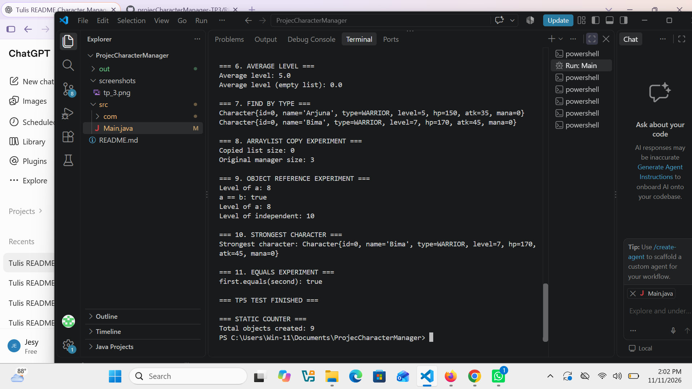
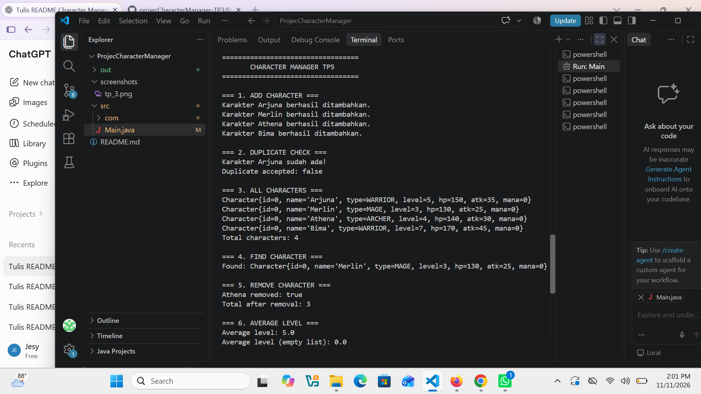

# Character Manager — TP3 & TP5
**Java Visual SIH-6406**

## 1. Deskripsi Proyek

Character Manager adalah aplikasi sederhana berbasis Java yang digunakan untuk mengelola karakter dalam sebuah game. Proyek ini dibuat untuk menerapkan konsep Object-Oriented Programming (OOP), seperti Class, Object, Constructor, Encapsulation, Getter, Setter, Enum, ArrayList, dan Object Reference.

## 2. Fitur Program TP3

- Membuat objek karakter menggunakan constructor.
- Menampilkan informasi karakter.
- Mengubah level karakter (Level Up).
- Mengatur nilai Mana karakter.
- Memvalidasi agar Mana tidak bernilai negatif.
- Memeriksa status karakter menggunakan method `isAlive()`.
- Menggunakan Enum untuk menentukan jenis karakter.

## 3. Jenis Karakter

Program memiliki empat jenis karakter:

- WARRIOR
- MAGE
- ARCHER
- HEALER

## 4. Struktur Folder Proyek

```text
ProjecCharacterManager/
│
├── src/
│   ├── Main.java
│   └── com/
│       └── unpri/
│           └── charactermanager/
│               └── model/
│                   ├── Character.java
│                   ├── CharacterType.java
│                   └── CharacterManager.java
│
├── screenshots/
│   ├── tp_3.png
│   ├── tp_5.png
│   └── tp5.png
│
└── README.md
```

## 5. Screenshot Hasil Program TP3

Screenshot berikut menunjukkan hasil eksekusi aplikasi Character Manager pada TP3.


## 6. Identitas Mahasiswa

- **Nama:** Jesy Pranisya Br Bangun
- **NIM:** 253303621230
- **Program Studi:** Sistem Informasi
- **Universitas:** Universitas Prima Indonesia
- **Mata Kuliah:** Pemrograman Berorientasi Objek
- **Tugas:** Character Manager Sprint #1 (TP3) dan Sprint #2 (TP5)

## 7. Dokumentasi Google Docs TP3

Dokumentasi analisis dan pembahasan tugas TP3 dapat dibuka melalui tautan berikut:

[Klik di sini untuk membuka Google Docs TP3](https://docs.google.com/document/d/1u7Xp926uOyoA4-ykONDtI0S-yILRtdFkxvSFbVrXS6k/edit?usp=sharing)

---

# TP5 — Character Manager Sprint #2

## 8. Fitur yang Diimplementasikan

Pada TP5, aplikasi dikembangkan dengan menambahkan pengelolaan karakter menggunakan ArrayList dan beberapa method tambahan.

1. **equals():** Membandingkan karakter berdasarkan nama tanpa membedakan huruf besar dan kecil.
2. **addCharacter():** Menambahkan karakter baru dan menolak nama karakter yang duplikat.
3. **findByName():** Mencari karakter berdasarkan nama.
4. **removeCharacter():** Menghapus karakter dari daftar.
5. **getTotalCharacters():** Menghitung jumlah karakter yang tersimpan.
6. **getAllCharacters():** Mengembalikan salinan daftar karakter agar daftar asli tidak dapat diubah melalui daftar hasil pengembalian.
7. **getAverageLevel():** Menghitung rata-rata level karakter dan menghasilkan 0 jika daftar kosong.
8. **findByType():** Mencari karakter berdasarkan jenis karakter.
9. **findStrongest():** Menemukan karakter dengan attack power tertinggi.
10. **Static Counter:** Menghitung jumlah objek Character yang telah dibuat.

## 9. Hasil Pengujian TP5

Pengujian dilakukan melalui program Main.java.

Hasil pengujian menunjukkan:

- Penambahan empat karakter berhasil.
- Nama karakter duplikat berhasil ditolak.
- Pencarian karakter Merlin berhasil.
- Penghapusan karakter Athena berhasil.
- Jumlah karakter setelah penghapusan menjadi 3.
- Rata-rata level karakter menghasilkan 5.0.
- Rata-rata pada daftar kosong menghasilkan 0.0.
- Pencarian karakter berdasarkan tipe WARRIOR berhasil.
- Pengujian salinan ArrayList berhasil.
- Pengujian object reference berhasil.
- Method equals() berhasil membandingkan nama karakter.
- Method findStrongest() berhasil menemukan karakter Bima.
- Static counter berhasil menghitung 9 objek yang dibuat.

## 10. Alasan Memilih Fitur findStrongest()

Fitur `findStrongest()` dipilih karena dapat membantu mengetahui karakter yang memiliki attack power tertinggi. Fitur ini berguna dalam pengelolaan karakter game dan melatih penggunaan perulangan, percabangan, serta pengambilan data dari ArrayList.

## 11. Screenshot Hasil Program TP5

### Screenshot 1



### Screenshot 2



## 12. Dokumentasi Google Docs Analisis TP5

Dokumentasi analisis TP5 membahas beberapa materi, yaitu:

- Perbedaan primitive dan reference semantics.
- Alasan penggunaan static counter.
- Perbedaan Object.equals() dan equals() yang telah diubah.
- Risiko mengembalikan ArrayList asli.
- Kesimpulan hasil pembelajaran TP5.

[Klik di sini untuk membuka Google Docs Analisis TP5]([Klik di sini untuk membuka Google Docs TP5](p=sharing)